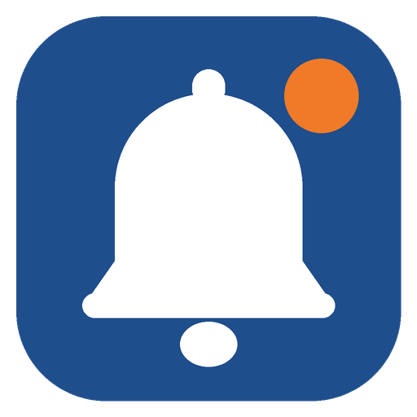
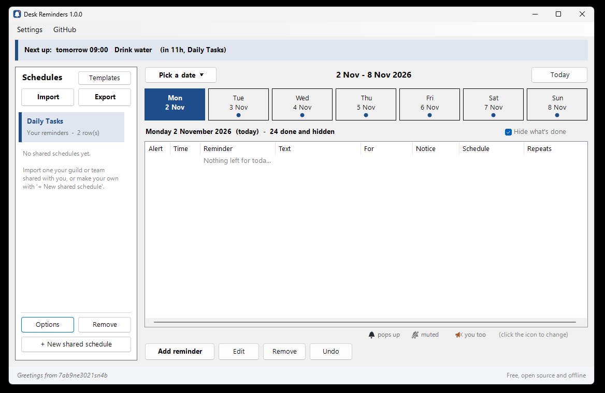
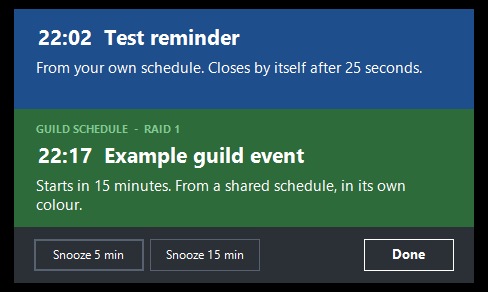
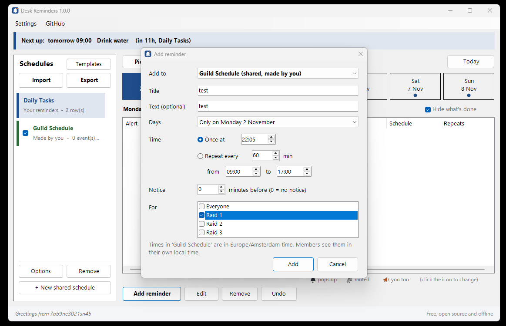
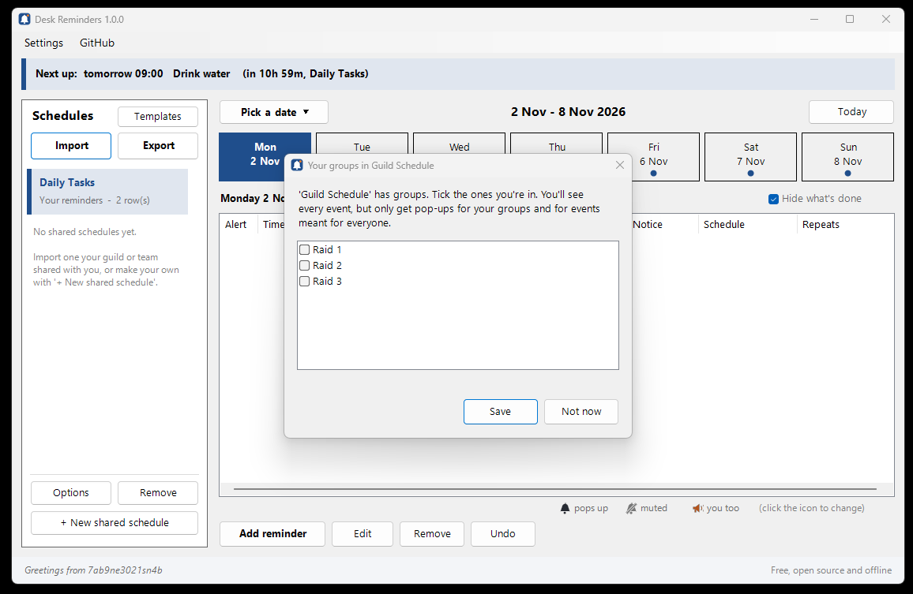

<p align="center">
  
</p>

<h1 align="center">Desk Reminders</h1>

<p align="center">
  Small, free pop-up reminders for Windows that stay out of your way.<br>
  Made for long gaming and work sessions: move, drink water, eat, sleep.
</p>

<p align="center">
  <a href="https://github.com/7ab9ne3021sn4b/DeskReminders/releases/latest"></a>
  
  <a href="LICENSE"></a>
  <a href="https://ko-fi.com/7ab9ne3021sn4b"></a>
</p>

<p align="center">
  
</p>

<p align="center">
  
  <br><sub>One pop-up for everything at the same minute, each schedule in its own colour. Snooze or close it.</sub>
</p>

## What it does

- **Pop-ups at the times you choose**, in the corner and on the screen you pick, with a soft chime.
- **Never steals focus.** Your keypresses keep going to the game or app you're in.
- **Closes by itself after 25 seconds**, or **snooze** it for 5 or 15 minutes.
- **One clear window**: your schedules on the left, your week on the right, a *Next up* bar
  and no files to edit.
- **Soft sounds of its own**: Soft chime, Warm bell, Marimba, Kalimba, Glass, Music box, Rising,
  Soft ping and Water drop. Or use your own `.wav`.
- **Ready-made templates** to start fast: hydration, moving, eye breaks, meals, bedtime.
  Pick one and adjust the interval, times or glass size to how you like it.
- **Repeating reminders**, like "every 60 minutes from 10:00 to 17:00, on weekdays".
- **One-off days**: a single date, a date range, or clear your usual schedule for a day.
- **Notices**: get a heads-up a few minutes before something starts ("Raid night in 30 minutes").
- **Shared schedules for guilds and communities**: import your guild's events next to your own
  reminders. Times are converted to your local time, and your own schedule is never touched.
- **Groups**, e.g. five raid teams in one guild schedule: everyone sees every event, but you
  only get pop-ups for your own team and for guild-wide events.
- **The bell and the megaphone**: mute any single event with one click, or get another group's
  pop-up too.
- **Colours per schedule**: your reminders are blue, the first shared schedule green, the next
  one purple, and so on. Change any of them.
- **Quiet hours**, with a choice per schedule whether it may still come through.
- **Undo**, **backup and restore**, and **Start with Windows** in one click.
- **Tiny and transparent**: one PowerShell script you can read. No installer, no account,
  no internet connection, no data collected. Free, open source and offline.

## Download and install

1. Download **DeskReminders-vX.Y.Z.zip** from the
   [latest release](https://github.com/7ab9ne3021sn4b/DeskReminders/releases/latest).
2. Right-click the zip, choose **Extract All**, and put the folder somewhere permanent,
   like `Documents\DeskReminders`.
3. Double-click **Start-Reminders.cmd**. After a short welcome the main window opens, and a
   blue bell stays in the system tray (bottom right; it may be hidden behind the `^` arrow).
4. Optional: **Settings** → *Start Desk Reminders when I log in* (or run **Add-To-Startup.cmd**).

> Windows may show **"Windows protected your PC"** the first time, because the app is new and
> not code-signed. Click **More info → Run anyway**. The full source is in this repository if
> you want to check it first. See [Troubleshooting](docs/troubleshooting.md).

**Requirements:** Windows 10 or 11. Nothing to install: it uses the PowerShell that ships with Windows.

## How to use it

Start it with **Start-Reminders.cmd**. A short welcome animation plays, then the main window opens.
The first time, Desk Reminders offers a few ready-made templates to start with; pick some or start empty.
Later, double-click the bell in the tray to open the window again.

<p align="center">
  
  <br><sub>Add reminder: once or repeating, a notice before it starts, and for guild schedules which group it's for.</sub>
</p>

The window has two parts:

- **Left: Schedules.** *My schedule* and every shared schedule you have, each in its own colour.
  **Import** and **Export** sit at the top, **+ New shared schedule** at the bottom.
  Click a schedule to select it; **Options** sets its colour, your groups and quiet hours.
- **Right: your week.** The *Next up* bar, the days (coloured dots show which schedules have
  something that day) and the reminders for the selected day.

| You want to… | Do this |
|---|---|
| See what's next | The **Next up** bar at the top. Today's list hides what's already done; untick *Hide what's done* to see it greyed out. |
| See a day | Click it in the week. **Pick a date** opens a calendar to jump to any date, or type one (e.g. `24-12-2026` or `24 dec`); **Today** jumps back. |
| Add a reminder | **Add reminder** → where to add it, title, optional text, days, time, notice. |
| Start from a template | **Templates** (top left, next to *Schedules*) → tick e.g. Hydration, set every how many minutes and how big a glass. |
| Change a reminder | Select it → **Edit** (or double-click it). |
| Remove a reminder | Select it → **Remove** (or press Delete). For repeating reminders you choose: only this day, or the whole reminder. |
| Mute one reminder | Click the 🔔 bell in the **Alert** column → it becomes 🔕 (that day, or every time). Click again to undo. |
| Changed your mind | **Undo** (or Ctrl+Z) takes back the last change. |
| Get a heads-up first | Set **Notice** to e.g. 15 minutes when adding a reminder. |
| Rename your schedule or change a colour | Select the schedule on the left → **Options** |
| Start over | Select your own schedule → **Remove** empties it (Undo brings it back). For a shared schedule, **Remove** takes it off your PC. |
| Not now | Click **Snooze 5 min** or **Snooze 15 min** on the pop-up. |
| No pop-ups at night | **Settings** → Quiet hours. Each schedule can still be let through (**Options**). |
| Pop-ups somewhere else | **Settings** → Pop-ups → corner and screen, then **Test**. |
| Change the sound | **Settings** → Sound → pick one (you hear it right away) or your own `.wav`, set the **Volume**, or turn it off. |
| Start with Windows | **Settings** → *Start Desk Reminders when I log in*. |
| Move to a new PC | **Settings** → **Back up**, then **Restore** on the new PC. |
| Take a break from reminders | Right-click the bell → **Pause** |
| Read the guides | **GitHub** in the menu bar: how to use, guides, troubleshooting, what's new. |

**In games:** use *windowed* or *borderless fullscreen*. In exclusive fullscreen Windows doesn't
let any window show on top, but you will still hear the chime.

### Editing the schedule by hand (optional)

Everything is stored in `schedule.csv` in the app folder, one reminder per row. You can edit it
in Notepad or Excel; the app picks up changes within 10 seconds.

```csv
Days,Time,Colour,Title,Text,Notice,For
Every day,08:30,,Breakfast,Time to eat something.,,
Mon-Fri,every 60 min 10:00-17:00,,Stand up,Stretch and drink some water.,,
2026-12-24,18:00,,Dinner,"Leave at 17:00, bring dessert",30,
```

Full format: **[docs/schedule-format.md](docs/schedule-format.md)**

## Shared schedules (guilds and communities)

One person makes the group's schedule in the app, everyone imports it:

1. **Organiser:** click **+ New shared schedule** (bottom left). Give it a name, pick the group's
   time zone ("server time") and, if you like, list your groups (e.g. *Raid Team 1* to
   *Raid Team 5*, one per line). Then add the first event straight away.
2. Add more events with **Add reminder** and choose the schedule under **Add to** (it's picked
   for you when that schedule is selected on the left). If the schedule has groups, tick who the
   event is **For**: *Everyone*, or one or more groups.
3. Click **Export** (top left). That saves a ready-to-post file; post it in Discord (or send it
   any way you like).
4. **Members:** click **Import** (top left), pick the file and tick your group(s).

Members see **every** event, so everyone knows what the guild is doing. Events for other groups
are greyed out and marked *(not you)*, and only events for *Everyone* and for your own groups pop up.

Exceptions are one click, right in the list:

- 🔔 → 🔕 **Mute**: click the bell of an event you don't need (e.g. you skip Thursday's raid).
  It stays in the list, without a pop-up. That day only, or every time.
- 🔕 → 📢 **Notify me too**: click the grey bell of another group's event (e.g. you fill in for
  Raid 2 this week) to get its pop-up anyway.
- Click again to switch back. When you import an update, the app tells you what changed for you.
Select the schedule on the left → **Options** to change your groups, its colour and whether it may
pop up during quiet hours. The checkbox on a schedule turns it on or off.

Changed something? **Export** again and post the new file. Members import it, and the app
tells them which version they had and which one they're getting.

Shared events show up next to your own, converted to your local time. Your `schedule.csv` is never
changed. Don't want a particular guild event? Select it in the list → **Remove** hides it for you
only (this day, or every time).

A schedule file only contains times and text, so importing one can't run anything on your PC.

<p align="center">
  
  <br><sub>Members tick their group(s) when they import. Only their events and the ones for everyone pop up.</sub>
</p>

Guide for organisers and members: **[docs/shared-schedules.md](docs/shared-schedules.md)**

## Updating

Quit Desk Reminders from the tray, then copy the files from the new zip over your old folder.
Your `schedule.csv`, your imported schedules (`shared` folder) and your settings (`settings.json`)
are never part of a download, so they stay as they are.

## Uninstalling

Untick *Start with Windows* in **Settings** (or run **Remove-From-Startup.cmd**), right-click the
bell → **Quit**, then delete the folder.
Nothing else is left on your PC.

## Privacy

Desk Reminders works completely offline, including shared schedules: you import them as files,
the app never downloads anything. It doesn't connect to the internet, collect data
or write anywhere except its own folder (and one shortcut in your Startup folder if you
choose Start with Windows). The only links in the app are under **GitHub** in the menu bar; they
open a page in your browser when you click them. Backups are saved only where you choose and
contain your own reminders, so keep them to yourself.

## Found a bug or have an idea?

[Open an issue](https://github.com/7ab9ne3021sn4b/DeskReminders/issues/new/choose).
Please include your Windows version and, if it's about a reminder, the row from your
`schedule.csv` (leave out anything private).

## Support the project

Desk Reminders is free and will stay free. If it helps you, you can buy me a coffee on
**[Ko-fi](https://ko-fi.com/7ab9ne3021sn4b)**. It keeps the bug fixes coming.

<a href="https://ko-fi.com/7ab9ne3021sn4b"></a>

## Licence

[MIT](LICENSE): free to use, share and change.
